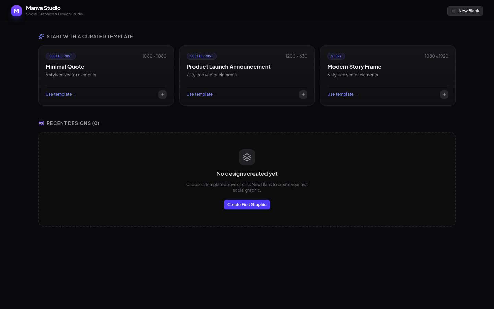
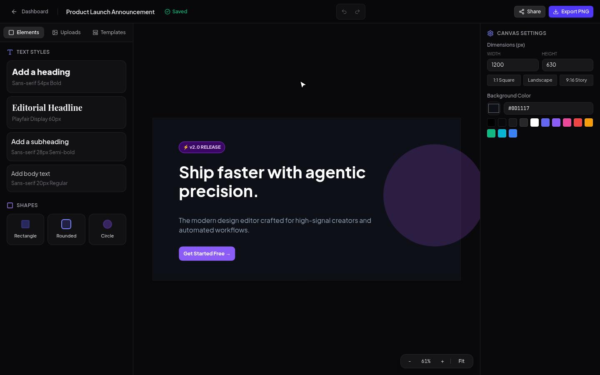
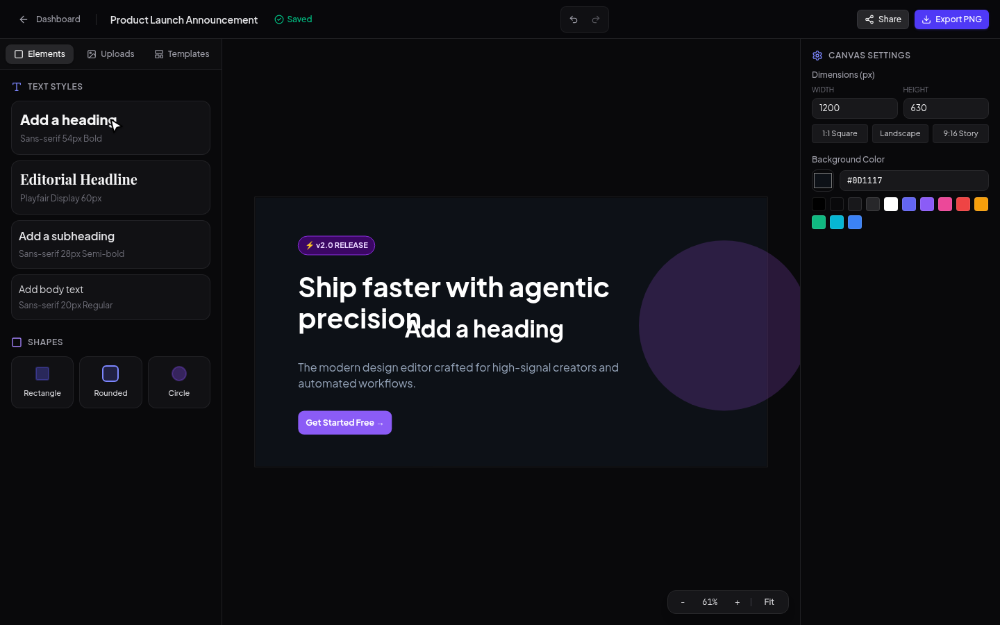
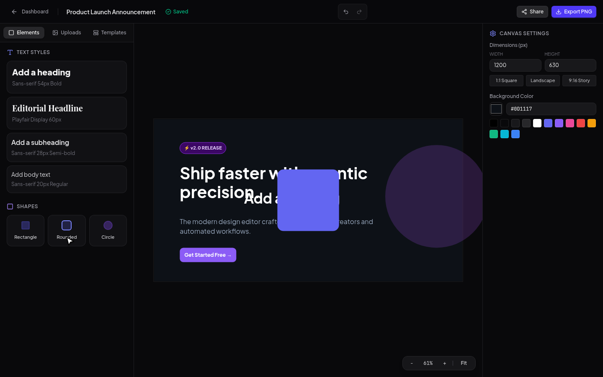
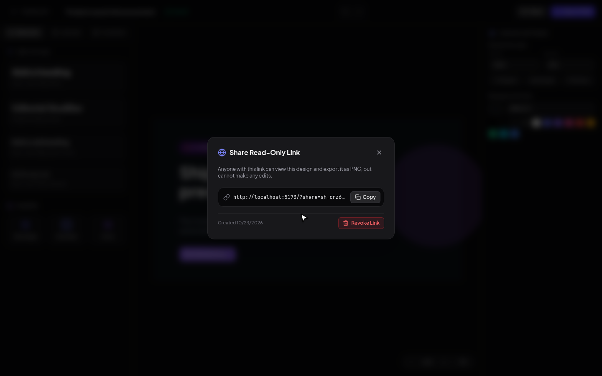
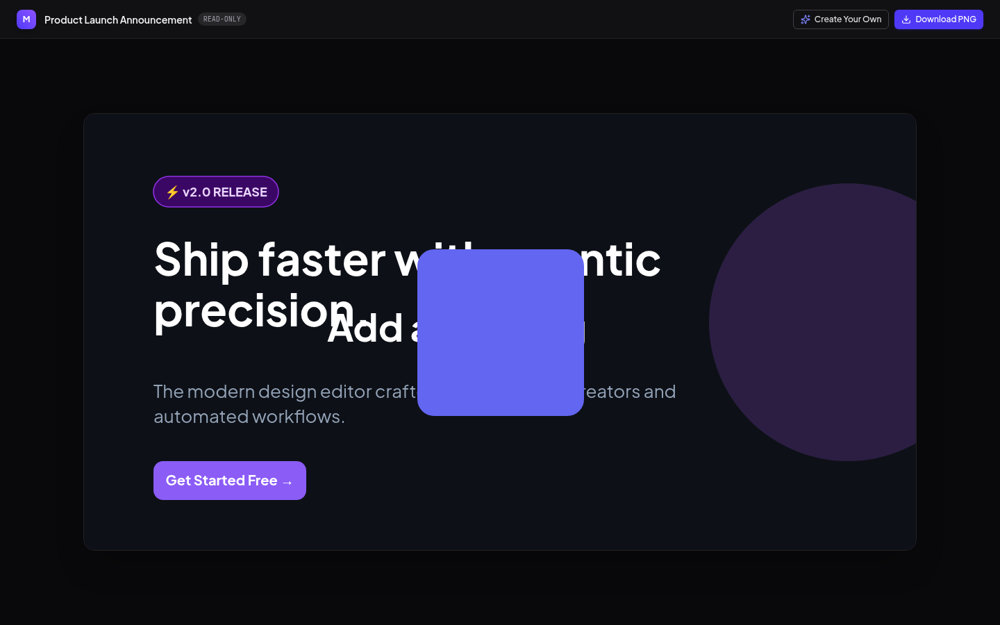

<div align="center">

# 🎨 Manva Studio

**A modern, local-first browser-based social graphics studio crafted for high-signal creators and automated workflows.**

Create stunning visuals for Twitter/X, LinkedIn, and Instagram from curated starter templates, customize vector shapes and typography, upload media, autosave locally, export faithful PNGs, and generate read-only preview links.

[](LICENSE)
[](https://www.typescriptlang.org/)
[](https://react.dev/)
[](https://tailwindcss.com/)
[](package.json)

<br/>

https://github.com/user-attachments/assets/a87e4aa8-fab1-49f4-9888-69ba3cce9395

</div>

---

## ✨ Features & Visual Tour

### 1. Template Launchpad & Local Dashboard
Start quickly with curated starter compositions (1080×1080 Square Post, 1200×630 Announcement, 1080×1920 Story) or create custom blank canvas presets. All your work autosaves securely to your browser's IndexedDB.

<div align="center">
  
</div>

---

### 2. Interactive Canvas Workspace
A responsive Konva canvas viewport equipped with zoom-to-fit, interactive transformer handles (drag, scale, rotate), and real-time bounding box constraints. Transient viewport state is kept completely separate from the persisted document model.

<div align="center">
  
</div>

---

### 3. Typography & Text Styling
Precise typographical controls with Google Fonts (`Plus Jakarta Sans`, `Playfair Display`, `JetBrains Mono`), font weight, font size, custom line-height, text alignment, and double-click in-canvas inline text editing.

<div align="center">
  
</div>

---

### 4. Vector Shapes & Stacking Order
Insert customizable rectangles with corner radiuses, ellipses, solid color fills, and strokes. Rearrange layer stacking order with intuitive controls (*Bring Forward*, *Send Backward*, *Bring to Front*, *Send to Back*).

<div align="center">
  
</div>

---

### 5. Instant Read-Only Public Sharing
Generate shareable read-only links (`?share=token`) with one click. Recipients receive a clean, locked view of your graphic and can download faithful PNG exports, without having permissions to modify your project. Authors can revoke public links at any time.

<div align="center">
  
  <br/><br/>
  
</div>

---

## 🏛 Architecture & Design Principles

Manva is architected around the hexagonal architecture (ports & adapters) pattern to remain clean, agentic, and easily extensible:

```text
src/
  app/                 Routes, app shell, composition root
  features/            Feature modules: dashboard, editor, templates, assets, sharing
  domain/              Core domain rules (zero framework/canvas/storage dependencies)
    design/            Document types, validation, migrations, pure commands
    editor/            Editor state, selection rules, 50-step undo/redo
    ports.ts           Declared repository and renderer contracts
  adapters/            Port implementations
    canvas-konva/      React Konva canvas renderer & gesture translation
    persistence/       IndexedDB design and share repositories
    asset-storage/     IndexedDB image blob storage
    export/            Offscreen Konva PNG renderer with font readiness
  ui/                  Accessible UI primitives and Tailwind v4 tokens
```

- **Zero-Dependency Domain:** `src/domain/` has no imports from React, Konva, IndexedDB, DOM nodes, or Supabase.
- **Strict Schema Versioning:** Every design document enforces a `schemaVersion` with runtime validation and migration paths in `src/domain/design/migrations.ts`.
- **Canvas Fidelity:** Exports match document pixel dimensions exactly, waiting for web fonts and image assets before generating PNG blobs.

---

## ⌨️ Keyboard Shortcuts

| Shortcut | Action |
|---|---|
| <kbd>Ctrl</kbd> / <kbd>Cmd</kbd> + <kbd>Z</kbd> | Undo last action |
| <kbd>Ctrl</kbd> / <kbd>Cmd</kbd> + <kbd>Y</kbd> or <kbd>Shift</kbd> + <kbd>Cmd</kbd> + <kbd>Z</kbd> | Redo action |
| <kbd>Ctrl</kbd> / <kbd>Cmd</kbd> + <kbd>D</kbd> | Duplicate selected element(s) with offset |
| <kbd>Delete</kbd> or <kbd>Backspace</kbd> | Delete selected element(s) |
| <kbd>Esc</kbd> | Clear selection / close modal |
| <kbd>Shift</kbd> + Click | Multi-select elements |
| <kbd>Double Click</kbd> on Text | Inline text editing overlay |

---

## 🚀 Quickstart

### Prerequisites
- Node.js >= 20.x
- pnpm >= 9.x

### Installation
```bash
git clone https://github.com/paramcodes/manva.git
cd manva
pnpm install
```

### Development
```bash
pnpm dev
```
Open [http://localhost:5173](http://localhost:5173) in your browser.

### Verification & Testing
```bash
# Typecheck
pnpm typecheck

# Unit tests
pnpm test:unit

# End-to-end browser journey verification via agent-browser
pnpm test:browser

# Production build
pnpm build
```

---

## 🤝 Contributing

Contributions, feature requests, and suggestions are welcome! Please read our [Contributing Guide](CONTRIBUTING.md) and [Code of Conduct](CODE_OF_CONDUCT.md).

1. Fork the repo.
2. Create a feature branch: `git checkout -b feat/my-feature`.
3. Commit your changes: `git commit -m "feat: add feature"`.
4. Ensure all tests and typechecks pass: `pnpm test`.
5. Open a Pull Request.

---

## 📄 License

This project is licensed under the [MIT License](LICENSE).
